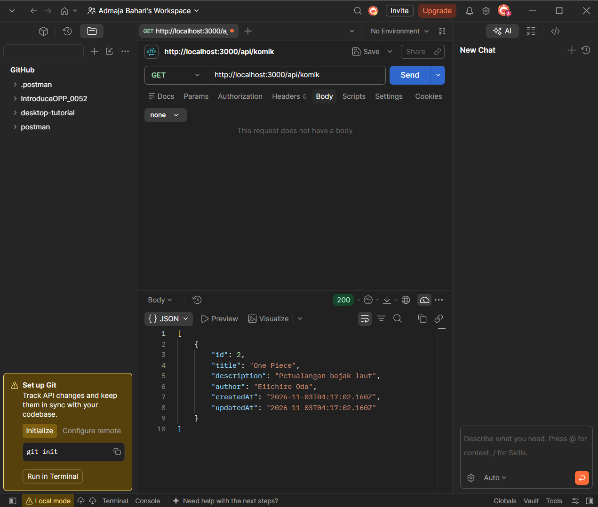
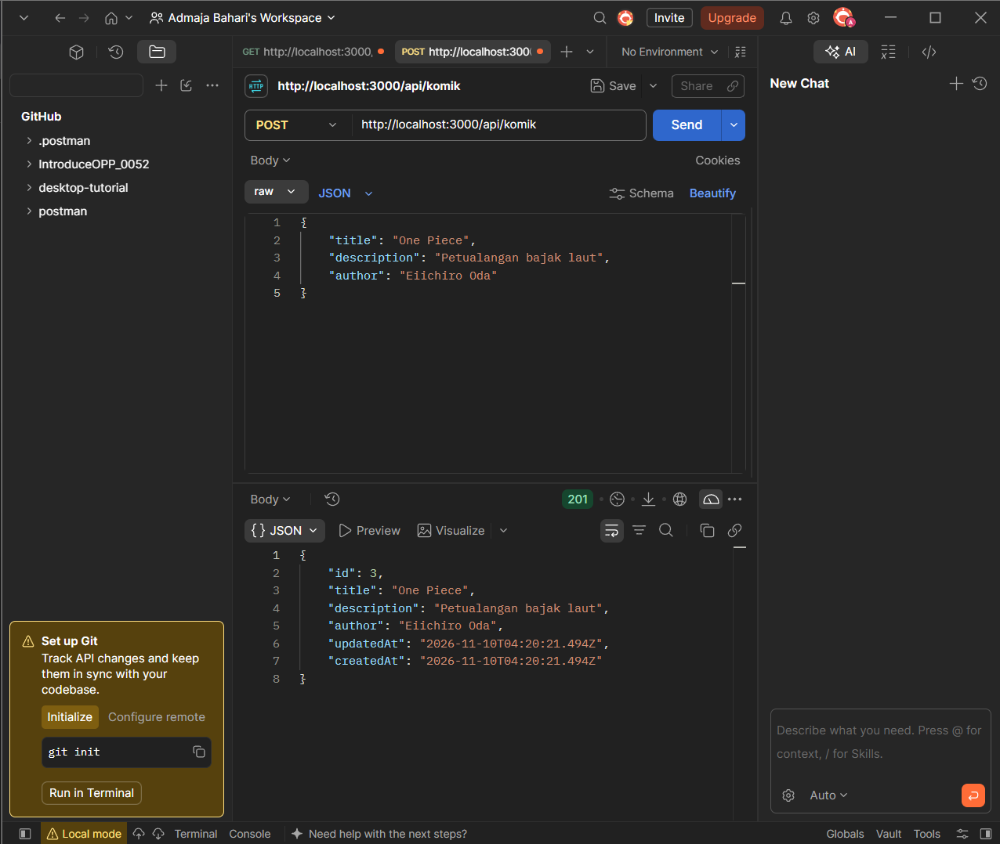
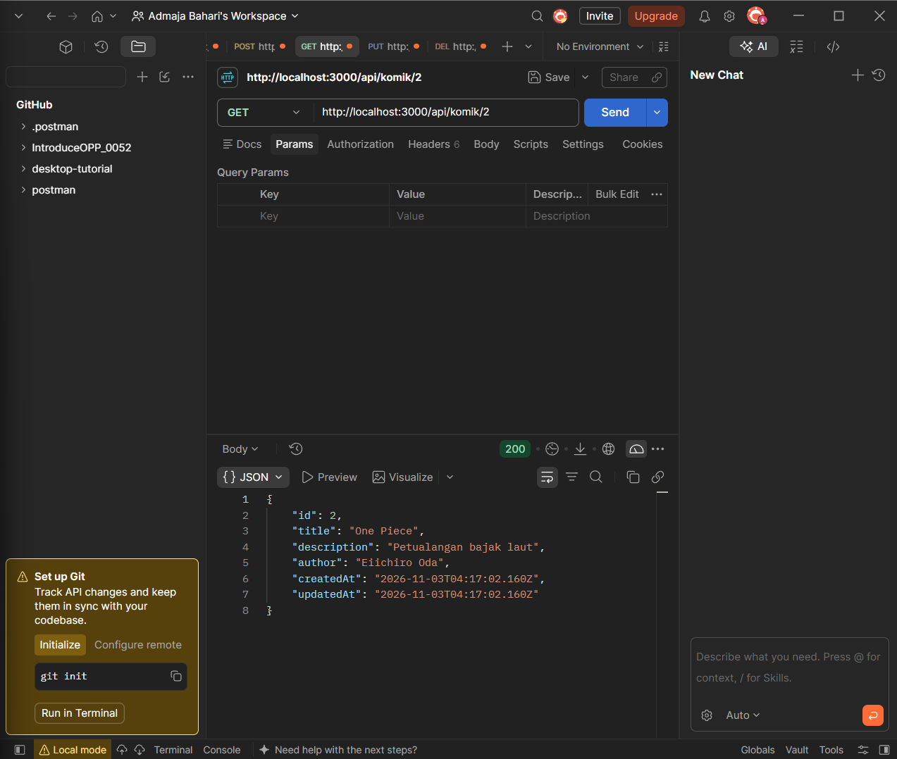
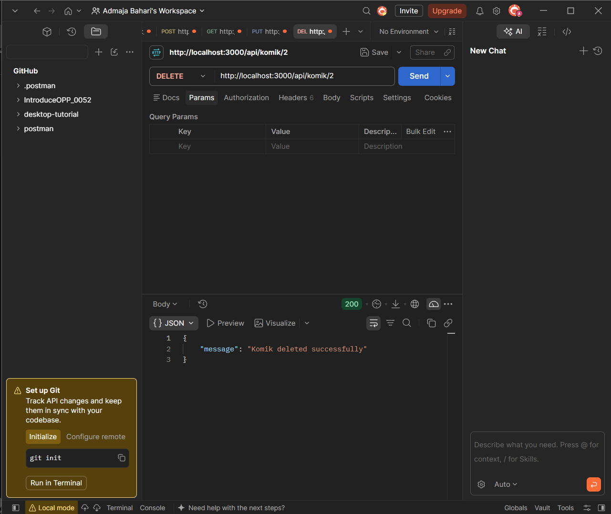
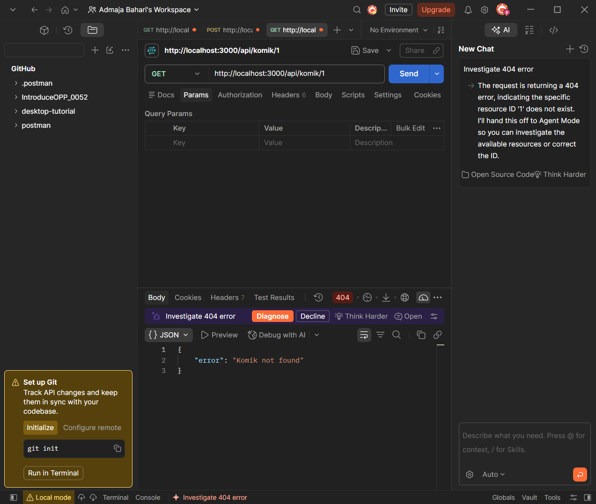
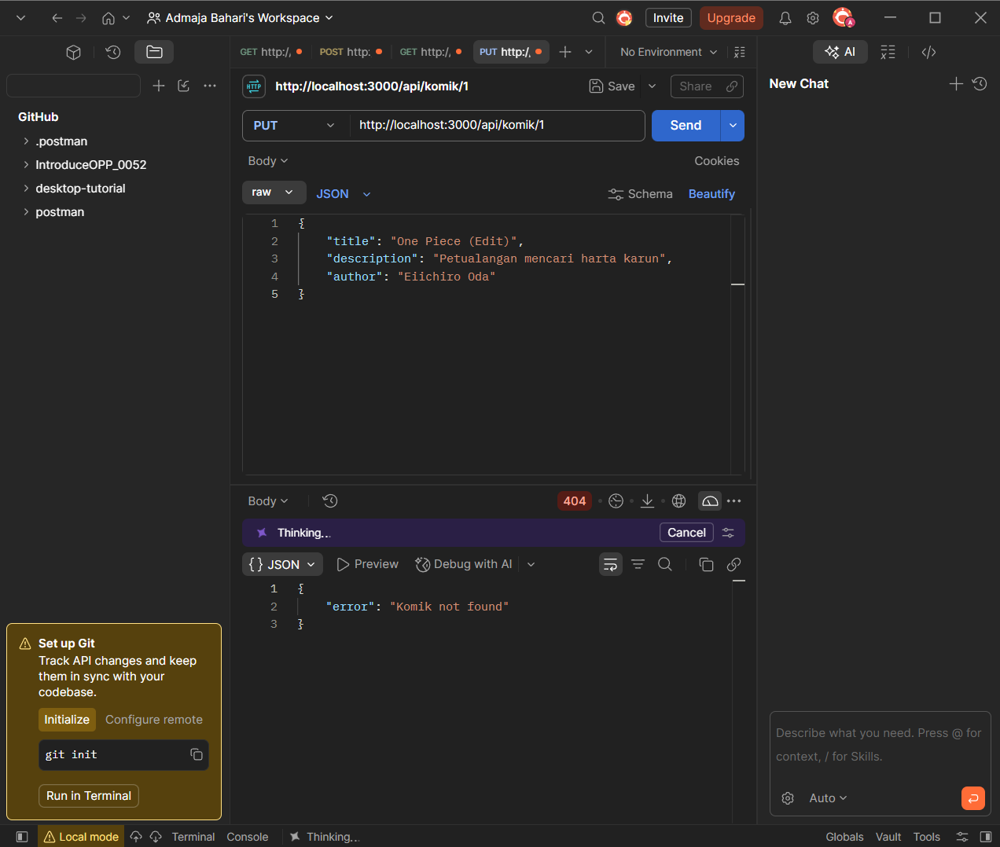
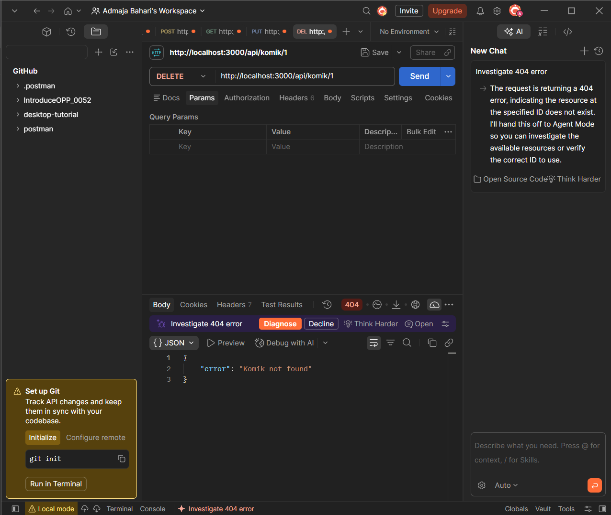

# 052_ORMCleanArchitecture

REST API sederhana untuk mengelola data **Komik** (CRUD) menggunakan **Express.js**, **Sequelize ORM**, dan **PostgreSQL**, dengan struktur folder yang terpisah antara route, controller, validasi, dan model.

## Teknologi

- Node.js + Express
- Sequelize ORM (+ Sequelize CLI)
- PostgreSQL (`pg`, `pg-hstore`)
- Joi (validasi input)
- dotenv (environment variable)
- nodemon (auto-restart saat development)

## Struktur Folder

```
052_ORMCleanArchitecture/
├── config/
│   ├── config.js          # Konfigurasi database (development & production)
│   └── db.js              # Fungsi koneksi dan sinkronisasi database
├── controllers/
│   └── komikController.js # Logika CRUD komik
├── docs/
│   └── images/            # Screenshot hasil pengujian Postman
├── Middleware/
│   └── KomikValidator.js  # Validasi body dan params dengan Joi
├── migrations/
├── models/
│   ├── index.js           # Loader model Sequelize
│   └── komik.js           # Model Komik
├── routes/
│   └── KomikRoutes.js     # Definisi endpoint
├── seeders/
├── .sequelizerc           # Konfigurasi path Sequelize CLI
├── .gitignore
├── index.js               # Entry point server
└── package.json
```

## Instalasi

1. Clone repository

```bash
git clone https://github.com/AdmajaBahari/052_ORMCleanArchitecture.git
cd 052_ORMCleanArchitecture
```

2. Install dependency

```bash
npm install
```

3. Buat file `.env` di root project

```env
PORT=3000
DB_USER=postgres
DB_PASSWORD=isi_password_postgres_kamu
DB_DATABASE=nama_database_kamu
DB_HOST=localhost
DB_PORT=5432
DB_DIALECT=postgres
```

4. Pastikan database PostgreSQL sudah dibuat, lalu jalankan server

```bash
npm start
```

Saat server berjalan, tabel `Komiks` dibuat dan disesuaikan otomatis lewat `sequelize.sync({ alter: true })`. Output yang diharapkan:

```
Database connection successful
Database synchronized
Server is running at http://localhost:3000
```

> **Catatan:** file `.env` sudah masuk `.gitignore` dan tidak ikut ke GitHub.

## Endpoint

Base URL: `http://localhost:3000/api`

| Method | Endpoint      | Deskripsi             | Validasi          |
|--------|---------------|-----------------------|-------------------|
| GET    | `/komik`      | Ambil semua komik     | -                 |
| GET    | `/komik/:id`  | Ambil komik berdasarkan ID | params       |
| POST   | `/komik`      | Tambah komik baru     | body              |
| PUT    | `/komik/:id`  | Ubah data komik       | params + body     |
| DELETE | `/komik/:id`  | Hapus komik           | params            |

## Skema Data

| Field         | Tipe    | Aturan                                  |
|---------------|---------|-----------------------------------------|
| `id`          | Integer | Primary key, auto increment             |
| `title`       | String  | Wajib, 1 sampai 255 karakter            |
| `description` | String  | Opsional, boleh kosong atau `null`      |
| `author`      | String  | Wajib, 1 sampai 100 karakter            |
| `createdAt`   | Date    | Diisi otomatis                          |
| `updatedAt`   | Date    | Diisi otomatis                          |

Field di luar tabel di atas akan ditolak (`allowUnknown: false`).

## Contoh Request dan Response

### GET `/api/komik`

Response `200`:

```json
[
    {
        "id": 3,
        "title": "One Piece",
        "description": "Petualangan bajak laut",
        "author": "Eiichiro Oda",
        "createdAt": "2026-11-10T04:20:21.494Z",
        "updatedAt": "2026-11-10T04:20:21.494Z"
    }
]
```

### POST `/api/komik`

Body:

```json
{
    "title": "One Piece",
    "description": "Petualangan bajak laut",
    "author": "Eiichiro Oda"
}
```

Response `201`:

```json
{
    "id": 3,
    "title": "One Piece",
    "description": "Petualangan bajak laut",
    "author": "Eiichiro Oda",
    "updatedAt": "2026-11-10T04:20:21.494Z",
    "createdAt": "2026-11-10T04:20:21.494Z"
}
```

### PUT `/api/komik/3`

Body:

```json
{
    "title": "One Piece (Edit)",
    "description": "Petualangan mencari harta karun",
    "author": "Eiichiro Oda"
}
```

Response `200`: data komik yang sudah diperbarui.

### DELETE `/api/komik/3`

Response `200`:

```json
{
    "message": "Komik deleted successfully"
}
```

## Respons Error

| Kondisi                              | Status | Contoh respons                                  |
|--------------------------------------|--------|-------------------------------------------------|
| Body tidak valid (kosong, field salah) | 400  | `Validation input gagal` beserta detail per field |
| ID bukan angka positif               | 400    | `Validation tidak valid` beserta detail         |
| Komik dengan ID tersebut tidak ada   | 404    | `{ "error": "Komik not found" }`                |
| Kesalahan server atau database       | 500    | `{ "error": "Failed to ..." }`                  |

Contoh respons validasi (`400`):

```json
{
    "success": false,
    "message": "Validation input gagal",
    "data": null,
    "error": [
        {
            "field": "title",
            "message": "\"title\" is required"
        },
        {
            "field": "author",
            "message": "\"author\" is required"
        }
    ]
}
```

## Pengujian

Semua endpoint diuji menggunakan Postman. Urutan pengujian: `POST` (tambah data), `GET` semua, `GET` by ID, `PUT`, `DELETE`.

### Hasil pengujian (berhasil)

#### GET semua komik (200)

Data yang tersimpan di PostgreSQL berhasil ditampilkan.



#### POST tambah komik (201)

Data komik baru berhasil dibuat dan `id` bertambah otomatis.



#### GET komik berdasarkan ID (200)

Data komik dengan `id: 2` berhasil ditampilkan.



#### PUT ubah komik (200)

Judul dan deskripsi komik `id: 2` berhasil diubah. Nilai `updatedAt` ikut berubah, sedangkan `createdAt` tetap.


#### DELETE hapus komik (200)

Komik `id: 2` berhasil dihapus dan server mengembalikan pesan `Komik deleted successfully`.



### Kasus error (data tidak ditemukan)

Permintaan ke `/api/komik/1` mengembalikan `404 Komik not found` karena komik dengan ID tersebut tidak ada. Ini membuktikan penanganan error pada controller berjalan dengan benar.

#### GET komik by ID tidak ditemukan (404)



#### PUT komik tidak ditemukan (404)



#### DELETE komik tidak ditemukan (404)



## Penulis

**Admaja Bahari** | [@AdmajaBahari](https://github.com/AdmajaBahari)